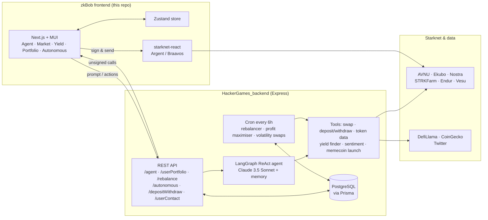

# StarknetHackerGames

### zkBob: an autonomous AI DeFi agent for Starknet

🏆 **1st place, Agentic track, Starknet Hacker Games**

[](https://starknet-hacker-games.vercel.app)
[](https://github.com/Devanshgoel-123/HackerGames_backend)


zkBob lets you run your Starknet DeFi portfolio by chatting. Ask it to analyse a token, find yield, swap, send funds to a saved contact by name, or rebalance your portfolio. You can also hand it a budget and let it trade on its own, within the stop-loss and profit targets you set.

This repo is the **Next.js frontend**. The agent, tools, and scheduled jobs live in [HackerGames_backend](https://github.com/Devanshgoel-123/HackerGames_backend).

## Features

| Module | What it does |
|---|---|
| **Agent chat** | A natural-language agent that can read on-chain data and prepare transactions for your wallet to sign |
| **Market analysis** | Token selector, price history charts, and an analysis chat that blends market data with Twitter sentiment |
| **Yield farm** | Compares pools across Starknet protocols and deposits or withdraws in one step |
| **Portfolio rebalancer** | Set a target split of stablecoins, native tokens, and other assets; the backend rebalances to it every 6 hours |
| **Autonomous mode** | Delegate funds to an agent wallet with a stop-loss, profit target, and deadline, then watch its trades live |
| **Contacts** | Save addresses under names ("send 10 STRK to Rahul") |

## Architecture



**How a request flows**

1. You type a prompt or click an action. The frontend calls the backend.
2. The LangGraph agent picks tools: it fetches prices and pool data, or builds swap and deposit calls through AVNU, Ekubo, STRKFarm, and Endur.
3. Calls that need your signature go back to the frontend, and your wallet signs them. Autonomous-mode trades are signed by the agent's own wallet and recorded in Postgres.
4. Cron jobs on the backend rebalance portfolios and run the profit and volatility strategies every 6 hours.

## Tech stack

**Frontend:** Next.js (App Router), React, TypeScript, MUI and MUI X Charts, Zustand, starknet-react, StarknetKit, SCSS

**Backend:** Express, LangChain / LangGraph, Anthropic Claude, Prisma, PostgreSQL, node-cron, starknet.js, AVNU SDK

## Getting started

```bash
git clone https://github.com/Devanshgoel-123/StarknetHackerGames.git
cd StarknetHackerGames/zkbob
npm install
npm run dev        # http://localhost:3000
```

The frontend expects the backend from [HackerGames_backend](https://github.com/Devanshgoel-123/HackerGames_backend) to be running. The deployed build points to `https://hackergames-backend.onrender.com`.

## Project structure

```
zkbob/src
├── app/                 Next.js routes, layout, wallet provider
├── store/               Zustand agent store
├── Components/
│   ├── Frontend/        Agent, MarketAnalysis, YieldFarm, Portfolio, AutonomousMode, Contacts
│   └── Backend/         Price history and top-pool fetchers, shared types and constants
└── Utils/
```
